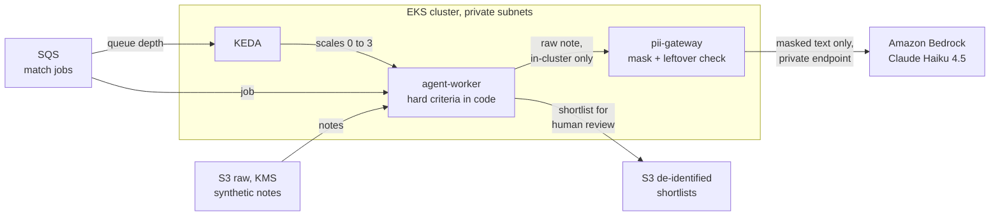
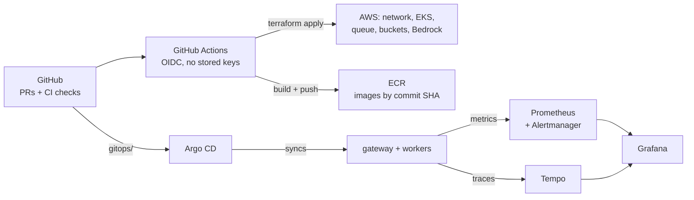
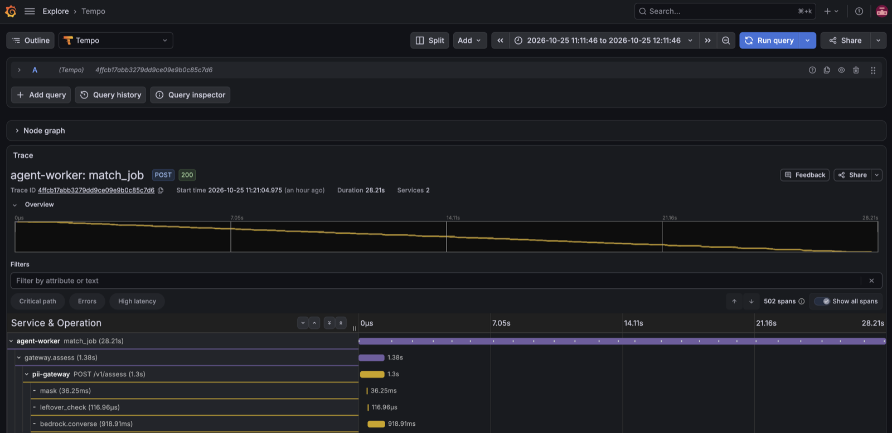
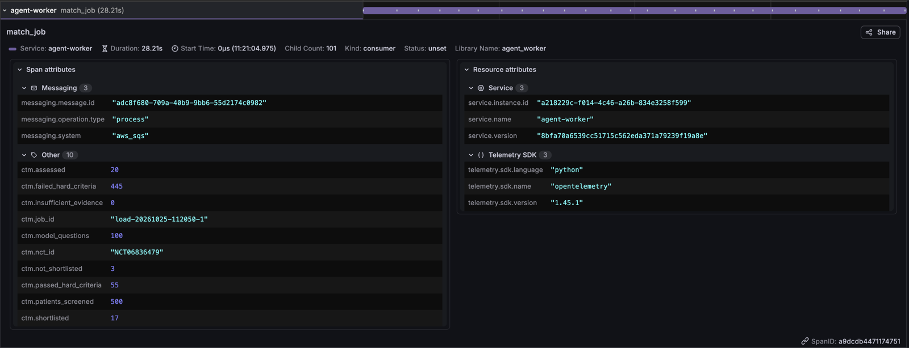
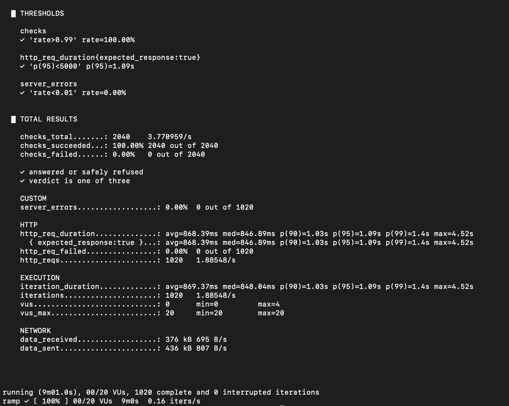
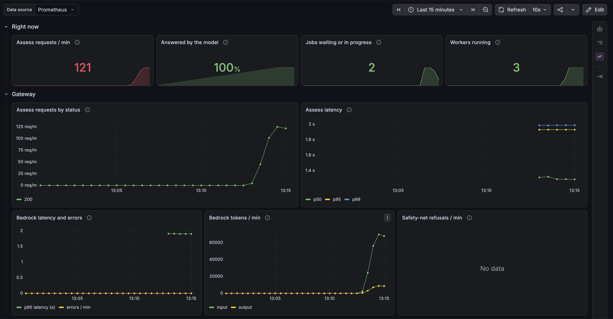
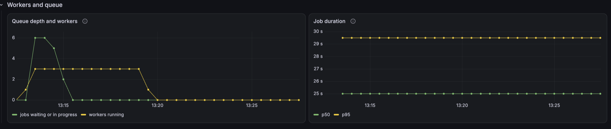
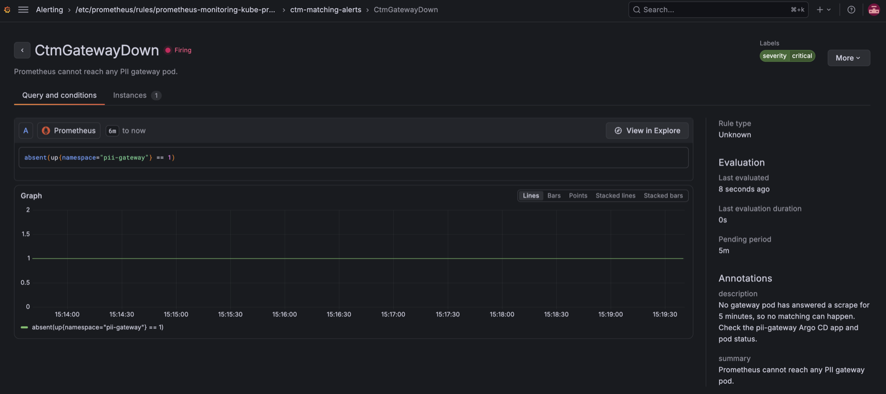

# clinical-trial-matching-llmops

**A production-style LLMOps platform on Amazon EKS that shortlists synthetic patients for clinical trials – routing every piece of clinical text through an in-cluster PII-masking gateway before it reaches Amazon Bedrock.**

> Portfolio project. All four phases are built and were proven on a live EKS cluster on 25 Oct 2026 (results below). The focus is the platform: infrastructure as code, GitOps delivery, keyless workload identity, network-enforced data protection, autoscaling and observability.

## Architecture at a glance

### How a match job flows



### How it's delivered and observed



- **Only the gateway can reach the model.** Its Pod Identity role is the only one allowed `bedrock:InvokeModel`, on the project's own inference profile; default-deny NetworkPolicies let the gateway and workers make HTTPS calls only to addresses inside the VPC, so Bedrock is reached through a private endpoint, never the internet.
- **Raw notes never leave the cluster unmasked.** The worker sends a note to the gateway inside the cluster; the gateway masks it, checks independently that no identifier survived, and only then calls Bedrock. A failed check means nothing is sent.
- **Nothing runs when there's nothing to do.** KEDA scales the workers from zero on queue depth; Karpenter adds nodes only when pods need them; the cluster itself is created and destroyed per session from Terraform.

## Ground rules

- **Synthetic data only.** Patients come from Synthea, trial criteria from ClinicalTrials.gov, and clinical notes are generated with planted fake identifiers. No real patient data is ever used.
- **Mask before any LLM – enforced by the network.** Only the PII gateway may reach Bedrock (NetworkPolicies + private VPC endpoints). Masking quality is measured against a labelled benchmark and gated in CI.
- **Decision support, not decisions.** The output is a shortlist with reasons for a human to review, never an eligibility verdict.
- **Rules in code, judgement in the LLM.** Age, sex and confirmed diagnoses are checked in code; the LLM handles free-text criteria.
- **Honest claims.** Designed with HIPAA-aligned controls. This project is not HIPAA-compliant and makes no such claim.

## Layers

| Layer | What runs there |
| --- | --- |
| **Infrastructure** | Terraform stacks: account guardrails, data (KMS-encrypted raw / de-identified buckets, SQS job queue + dead-letter queue, Bedrock application inference profile), registry, network with private endpoints, NAT, EKS, platform add-ons |
| **Delivery** | GitHub Actions with OIDC (no stored AWS keys): blocking Checkov, plan on PR, approval-gated apply, images tagged by commit SHA; Argo CD for everything in the cluster |
| **Security** | PII gateway (Presidio) as the only route to Bedrock; default-deny NetworkPolicies; EKS Pod Identity; External Secrets; per-dataset KMS and bucket policies |
| **Workloads** | Agent workers consuming SQS, scaled by KEDA (to zero when idle) on Karpenter nodes; gateway HPA and PDB |
| **Observability** | Prometheus + Grafana with the dashboard as code; SLOs with multi-window burn-rate alerts (rules unit-tested by promtool in CI); OpenTelemetry traces to Tempo, one trace per match job across both services. Metrics and spans carry counts and timings only, never note text |

## Phases

| Phase | Focus | Status |
| --- | --- | --- |
| 1 | Foundations: repo, bootstrap, CI/CD, guardrails, data stack, versioned datasets, PII gateway + benchmark gate | Done |
| 2 | Platform on EKS: network + private endpoints, NAT, cluster, Karpenter, Argo CD | Done |
| 3 | Bedrock as code, gateway on EKS, SQS + KEDA agent workers | Done (proven end to end 21 Oct) |
| 4 | Observability and resilience: OpenTelemetry, Prometheus/Grafana, SLOs, load and chaos tests | Done (proven on EKS 25 Oct) |

## Proven on EKS: observability and resilience (25 Oct 2026)

One working day on a fresh cluster: every number below was measured, not estimated.

### One match job, end to end

Each job is one trace: the worker's `match_job` span, a `gateway.assess` span for each of its 100 model questions, and inside each the gateway's own `mask`, `leftover_check` and `bedrock.converse` spans, joined across services by the W3C `traceparent` header. Most of each question's time is the model call (about 0.9 s of 1.3 s); masking takes about 40 ms.



The job span carries the result as counts, plus the image version. No patient IDs, note text or identifiers appear in any span (each service's tests search every span for them).



### Load test: the gateway against its SLOs

A k6 Job inside the cluster drove `/v1/assess` from 0 to 3 requests per second over 9 minutes, with synthetic notes containing planted fake identifiers.

| Measure | Result | SLO |
| --- | --- | --- |
| Requests | 1,020 | |
| Server errors | 0 | under 1% |
| Latency | median 0.85 s, p95 1.09 s, p99 1.4 s | 95% under 5 s |
| Bedrock throttling | none at 3 requests/s | |
| Gateway CPU | peaked at 15% of target on 2 pods; no scale-up needed | HPA at 70% |



### Queue burst: KEDA scaling from zero

Six jobs (600 model questions) queued at once: KEDA scaled the workers 0 → 3 within seconds (2 jobs per worker), all six results were written within 2 minutes, and the workers returned to 0 after the 5-minute cool-down.





### Chaos experiments

| Experiment | Recovery | Alerting |
| --- | --- | --- |
| Trace store (Tempo) killed mid-job | Matching unaffected; spans dropped, not queued | None, correctly |
| One gateway pod killed mid-job | No failed requests | None, correctly |
| Busy worker stopped politely (SIGTERM) | Finished its job, then exited | None, correctly |
| Busy worker killed with no warning | Job reappeared after the 5-minute visibility timeout and completed once | None, correctly |
| Every gateway pod killed | Both in-flight jobs failed, were retried and completed | `CtmJobsFailing` stayed silent (finding below) |
| KEDA paused with jobs waiting | Jobs waited, then drained on resume | `CtmQueueNotDraining` stayed silent (finding below) |
| Gateway down for 6 minutes | Back to 2 pods; jobs unaffected (workers paused) | `CtmGatewayDown` pending, firing, resolved |

No job was lost or processed twice in any experiment.



### What the tests found

Finding these was the point of the day. Each has a cause and a fix:

| Finding | Cause | Status |
| --- | --- | --- |
| A job showed up as 100 separate traces | Worker thread pool threads don't inherit the job's trace context | Fixed and verified the same day |
| Gateway logged `Failed to export metrics` (404) every minute, and likely exported spans twice | FastAPI's built-in telemetry reads the OTLP endpoint and adds its own exporters | Fixed (its exporters set to `none`) and verified |
| Dashboard request and latency panels, and both SLO rules, matched nothing | The app's `endpoint` label clashed with the scrape target's `endpoint` label and was renamed | Fixed (`honorLabels`) and verified |
| `CtmJobsFailing` silent during a real outage | Labelled counters are created at their first increment, so Prometheus never sees them rise from 0 | Open: create counters at zero on start-up; add a promtool case for it |
| `CtmQueueNotDraining` silent while KEDA was paused | KEDA stops publishing queue depth when paused | Open: alert on a paused ScaledObject and on the metric going absent |
| Experiment script raced the scale-from-zero delay | Fixed sleep instead of waiting for a busy worker | Open: wait for a running worker |

## Datasets (built in phase 1)


| Dataset | Bucket | What |
| --- | --- | --- |
| `patients/v1` | raw (KMS) | 1,000 living synthetic adults from Synthea v4.0.0 – reproducible byte for byte |
| `trials/v1` | de-identified | Snapshot of 30 recruiting trials; investigator contact details dropped at fetch |
| `notes/v1` | raw (KMS) | 500 clinical notes with 7,283 planted identifiers and an exact answer key – the gateway's benchmark |

Every dataset has a manifest (parameters, source, per-file SHA-256) and versions are never overwritten.

## Repository layout

```
terraform/
  bootstrap/        # state bucket, GitHub OIDC roles (applied once by an admin)
  modules/          # cost-guardrails
  stacks/           # permanent (00-account, 05-registry, 10-network, 18-data) and
                    # ephemeral (15-nat, 16-endpoints, 20-eks, 30-platform)
services/
  pii-gateway/      # FastAPI + Presidio: mask, leftover check, Bedrock; metrics and traces
  agent-worker/     # SQS consumer: hard criteria in code, free text via the gateway
gitops/             # Argo CD apps, overlays, monitoring (dashboard, SLO rules, Tempo)
loadtest/           # k6 gateway ramp and SQS queue burst
chaos/              # chaos experiments with hypotheses and expected alerts
tests/monitoring/   # promtool unit tests for the alert rules
scripts/data/       # dataset generation and snapshot scripts
docs/images/        # screenshots from the EKS proof session
.github/workflows/  # Terraform CI/deploy/destroy, image builds, manifests, alert rules
```
